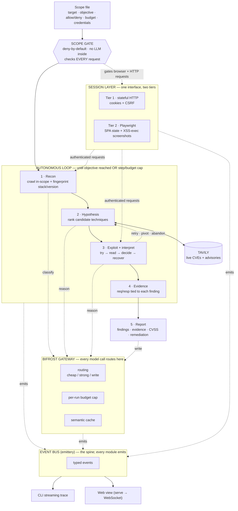

# Architecture

Nightfall is an autonomous black-box web-application pentest agent. Given a scope file
(a target, an objective, and an allow/deny list — no credentials or stack knowledge
required), it enumerates only in-scope surface, forms vulnerability hypotheses grounded
in live data, attempts them, interprets the results, recovers from failures on its own,
and produces a client-ready report. The whole run streams as a readable trace.

The system is **one control loop with a hard scope gate in front of it**: Bifrost as
the model layer every reasoning step goes through, Tavily as the live-data oracle the
hypothesis step calls, and a two-tier session layer behind one interface. The scope
gate is deliberately outside the LLM — strict scope adherence is pass/fail, so it must
not depend on a model choosing to behave. Every module emits typed events to one bus;
the CLI, the web view, and the evidence store are all sinks on that stream.

## Data flow



**In one line:** scope file → gate (deny-by-default) → loop{ recon → hypothesis (calls
Tavily) → exploit + interpret (loops back) → evidence } → report; every reasoning step
calls a model through Bifrost; the session layer supplies authenticated requests to
recon/exploit and is itself gated; every module emits typed events to the bus, which
the CLI and web view render.

## Components

1. **Scope gate** (`scope/gate.ts`, deterministic, non-LLM). Parses the scope file into
   an allowlist of hosts/paths; deny-by-default. Every outbound request from any module
   is checked here first. A blocked request is logged (`scope.blocked`) and the loop is
   told — never silently dropped. This is the most important correctness surface in the
   repo. See [Scope gate](#scope-gate-safety-critical) below.
2. **Recon** (`recon/index.ts`). Crawls in-scope surface and fingerprints the stack
   (headers, cookies, JS bundles, error signatures, known paths). Deterministic where
   possible; a cheap-model call only to classify ambiguous output. Optionally enriches
   with `httpx` tech-detect (and `nmap -sV` when `NF_RECON_NMAP=1`) if the binaries are
   installed — both gate-checked, both best-effort. `ffuf`/`nuclei` are not wired.
3. **Hypothesis + live lookup** (`hypothesis/tavilyClient.ts`). For each fingerprinted
   `(component, version)`, queries Tavily for current CVEs/advisories, then ranks
   candidate techniques grounded in that fresh data. This is also where the ablation
   measures grounding's effect.
4. **Exploit + interpret loop** (`loop/agent.ts`, `loop/actions.ts`, `loop/interpret`).
   Picks a candidate, runs the attempt via the session, reads the response, and decides:
   `retry` a variant, `escalate`, `abandon` the path, or `pivot`. Technique dispatch is
   per-class (SQLi, XSS, CSRF, traversal, command injection, broken access control), with
   an always-on broken-access probe as the floor.
5. **Evidence store** (`evidence/store.ts`). Every request/response pair tied to the
   finding it supports, captured as it happens (append-only JSONL) — the source of truth
   the report reads back.
6. **Report generator** (`report/generate.ts`). Consumes structured findings + evidence
   and emits a client-ready Markdown report: metadata and run provenance, a
   severity-counted summary, then one dressed section per finding (severity, CVSS vector
   and score, in-scope request/response evidence, remediation), most-severe first. A PDF
   export (`marked → HTML → puppeteer`) is a polish-window stretch; Markdown is canonical.

## The decide/recover loop

The loop is a bounded state machine:

```
state = { steps: 0, maxSteps, budget, objectiveReached: false }
emit run.start
recon() -> fingerprints            # through the session; gate-checked
queue   = grounded candidates (per fingerprint, via Tavily) + always-on access probes
while queue not empty and not objectiveReached and steps < maxSteps and budget not hit:
    gateway.budget.assertUnder()   # budget cap can halt here
    result   = attempt(candidate)  # via the session; gate-checked
    decision = interpret(result)   # classify output -> next action
    emit exploit.interpret(decision)
    if result.confirms_finding:
        evidence.record(finding); emit finding.confirmed
        if finding.reaches_objective: objectiveReached = true; break
    match decision:
        retry    -> retry a bounded variant of this candidate
        escalate -> deepen on this path (e.g. Tier-2 browser)
        abandon  -> drop this candidate, take the next
        pivot    -> re-run hypothesis with new context
    steps += 1
emit objective.reached? / run.end
```

**Invariants (never violated):**

- The loop **always terminates** — objective reached, step cap, or budget cap. No
  unbounded retries; a stuck run halts cleanly rather than hanging or crashing.
- Every request inside `attempt`/`recon` is gate-checked. No exceptions.
- Every model call goes through the gateway, so cost/budget/cache are always counted.
- Recovery is first-class: a failed attempt is a normal event, not a run-ending error.

## Scope gate (safety-critical)

Deny-by-default. A request is allowed **only if** its scheme is `http`/`https`, its host
is in `allow.hosts`, its path matches an allow prefix (on path-segment boundaries, so
`/app` covers `/app/x` but never `/apple`), and it matches no deny prefix. Everything
else is denied.

- **No LLM/model call ever lives inside the gate.** It is pure, deterministic logic.
- It errs **closed**: unparseable URL → deny; non-http(s) scheme → deny; ambiguous → deny.
- It is enforced at **both** transport layers — the HTTP client (`session/httpSession.ts`)
  and the Playwright `route` handler (`session/browserSession.ts`) — so a browser
  navigation cannot sneak around it.
- **Redirects are re-gated.** The HTTP client follows redirects manually and checks every
  hop against the gate, so an in-scope URL that redirects out of scope is refused rather
  than followed.
- It is the **most-tested file in the repo**, attacked adversarially: out-of-scope hosts,
  path traversal (`/app/../admin`) and its encoded form (`%2e%2e`), `userinfo@host`
  confusion, IP literals when only a hostname is in scope, trailing-dot and IDN host
  variants, and non-http(s) schemes. Any single leak is an automatic challenge failure.

Known limitation: the gate matches on hostname, not resolved IP, so it does not defend
against DNS rebinding — appropriate for an isolated-lab engagement, documented rather
than implied away.

## Session layer

Two tiers behind one `Session` interface, so the loop never cares which is in use:

- **Tier 1 — stateful HTTP** (`session/httpSession.ts`). `fetch-cookie` + `tough-cookie`;
  logs in once per auth boundary, holds the cookie jar and CSRF token, tags authenticated
  requests. Covers authenticated SQLi/IDOR/path-traversal, CSRF-aware requests, multi-step
  flows, stored-XSS sequencing.
- **Tier 2 — headless browser** (`session/browserSession.ts`). Playwright for JS-driven
  login/auth state, SPA client-side state, and confirming an XSS actually executes (a
  screenshot is stronger report evidence). Gate-enforced at the browser level; a flaky
  browser run degrades to a skipped check, never a loop crash.

DVWA and WebGoat are server-rendered (Tier 1 sees them fully); **Juice Shop is a
JavaScript SPA** and is the Tier-2 proving ground. The scope schema has an optional
`credentials` block for authorized authenticated testing — credentials only
_authenticate_, they never _widen_ scope, and the gate still governs every request. Test
credentials come from the scope file at runtime and are never committed.

## Bifrost — the model gateway

Bifrost (Maxim AI's open-source, OpenAI-compatible LLM gateway) is literally in every
model call: the `openai` SDK is pointed at the Bifrost base URL.

- **Routing.** A cheap model for classification/extraction, a strong model for exploit
  reasoning, a clean writer for the report (`NF_MODEL_CHEAP`/`STRONG`/`WRITE`) — real cost
  deltas per step.
- **Real per-call cost.** Priced from Bifrost's live `/v1/models` catalog
  (`gateway/catalog.ts`) and tagged with its source on each `gateway.call` event; no
  hard-coded numbers.
- **Budget cap.** A per-run budget (`gateway/budget.ts`). Crossing it raises a typed
  `BudgetExceededError` the loop catches, halting cleanly (`halted: budget`).
- **Cache.** The client reads the `x-bifrost-cache-hit` header, so a repeated call is
  served at $0.

## Tavily — grounding, measured

In the hypothesis step, for each fingerprinted `(component, version)`, Tavily returns
current CVEs/advisories so the agent reasons from fresh data rather than stale model
memory. Grounding's value is **measured, not asserted**, via an ablation that runs the
hypothesis step twice from identical recon input — grounded vs. the Tavily call stubbed —
holding model, routing, temperature, and seed fixed.

| Metric                 | What it measures                                                                        | Role              |
| ---------------------- | --------------------------------------------------------------------------------------- | ----------------- |
| **Citation validity**  | % of ranked candidates whose cited CVE/advisory actually applies to the fingerprint     | Headline          |
| **Freshness**          | % of grounded candidates citing an advisory published after the model's training cutoff | Headline          |
| Hypothesis→finding p@3 | % of top-3 candidates that led to a confirmed finding through the real loop             | Supporting, noisy |

Effect size varies by lab: old, well-known components (DVWA/WebGoat) move the needle
less; the win shows on recent advisories. Both raw ranked lists are kept verbatim so the
delta is reproducible from frozen inputs.

## Event bus

One typed `emittery` bus (`events/bus.ts`) with one event map (`events/types.ts`). Every
module _emits_; no module prints. The CLI renderer, the evidence store, and the web view
(`serve` forwards every event over a WebSocket with a replayed backlog) are all sinks on
the same stream — which is why the demo, the logs, the audit trail, and the report all
read from one source.

## Stack

TypeScript end to end, pnpm workspaces + turborepo.

| Layer                  | Choice                                                    |
| ---------------------- | --------------------------------------------------------- |
| Language / build       | TypeScript, tsup, tsx                                     |
| Lint / format          | biome                                                     |
| Tests                  | vitest                                                    |
| Validation             | zod (scope file, events, tool output, LLM outputs)        |
| Event bus              | emittery                                                  |
| Process spawn          | execa (`httpx` tech-detect; optional `nmap`)              |
| HTTP / crawl           | native fetch + cheerio                                    |
| Models (Bifrost)       | `openai` SDK → Bifrost base URL                           |
| Live research (Tavily) | `@tavily/core`                                            |
| Session Tier 1 / 2     | fetch-cookie + tough-cookie / playwright                  |
| Evidence               | append-only JSONL                                         |
| Report                 | Markdown (canonical); `marked → HTML → puppeteer` for PDF |
| CLI                    | commander + picocolors + ora + a streaming renderer       |
| Web                    | vite + react + ws                                         |

## Repo layout

```
nightfall/
  apps/
    cli/src/{index.ts, render.ts}      # the `nightfall` command + streaming trace
    web/                               # vite + react live view over the serve WebSocket
  packages/core/src/
    events/{bus.ts, types.ts}          # the event spine
    scope/{schema.ts, gate.ts, example.scope.yaml}
    recon/{index.ts, fingerprint.ts}
    hypothesis/{tavilyClient.ts, ablation.ts, precision.ts}
    loop/{agent.ts, actions.ts, interpret.ts}
    gateway/{bifrostClient.ts, catalog.ts, pricing.ts, routing.ts, budget.ts}
    session/{index.ts, httpSession.ts, browserSession.ts}
    evidence/{store.ts, models.ts}
    report/{generate.ts}
  packages/core/test/                  # gate + loop + session + ablation tests
  labs/docker-compose.yml              # DVWA, Juice Shop (SPA), WebGoat
```

The single most important file is **`scope/gate.ts`** — small, deterministic, no LLM,
most-tested.
