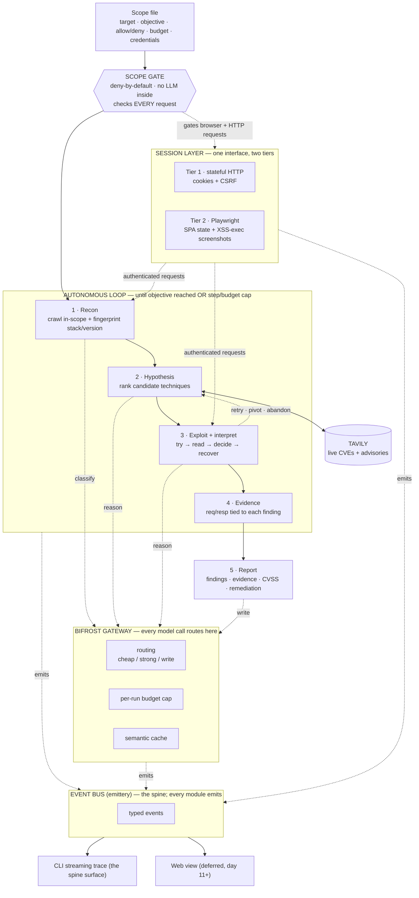

# NIGHTFALL — Source of Truth

> **What this document is.** The single canonical reference for the Nightfall project: our entry in the **Geek Room Global AI Hackathon 2026**, Track A / Challenge 03. It lives at repo root and is read-only during the build unless a decision genuinely changes. When anyone — human or agent — is confused about _what we're building, why, how, or to what standard_, this file is the answer. If another doc disagrees with this one, this one wins until it's updated. It is deliberately verbose: optimized to be understood by a teammate at 2am and by an AI agent with no prior context, not to be short.
>
> **Precedence when sources conflict:** this file → the per-role briefs (`ROLE_R1/R2/R3_*.md`) → the scaffold spec (`BOOTSTRAP.md`) → inline code comments. The official hackathon brief and the event page override all of the above on _rules_ (dates, submission, scope).

> **Context & authorization.** Challenge 03 is an **authorized penetration-testing agent that runs only inside an isolated lab the organizers supply** — the judges provide the scope file, the target, and the objective on judging day. No public, real-world, or non-consenting systems are ever in scope; that is the explicit rule of the challenge. This repository is a control loop, a crawler, a session layer, an LLM-gateway client, a web-research client, an evidence/report pipeline, and a deny-by-default safety gate. It contains no generalized exploit toolkit; attempt logic is written narrowly against the sanctioned lab, by hand. Everything here is legitimate, scoped security engineering.

---

## 0. The one-paragraph version

Nightfall is an autonomous agent that performs an authorized penetration test of a web application with **no human at the keyboard**. Given a scope file and a target, it enumerates only in-scope surface, forms vulnerability hypotheses **grounded in live data** (Tavily), attempts them, interprets the results, recovers from failures on its own, and produces a **client-ready report** (findings, evidence, CVSS severity, remediation). Every model call routes through **Bifrost** for cost-aware routing, a per-run budget cap, and caching. A **deny-by-default scope gate** sits in front of everything so the agent provably cannot act out of bounds. The whole run streams as a readable trace you launch and _watch_ — Nightfall is watch-not-drive.

---

## 1. The operating persona — adopt this, always

There is exactly one stance for this project. Whether you are a teammate or an AI agent working in this repo, you operate as:

**A top-0.01% engineer in a global hackathon, gunning hard for the win, who reasons by postmortem and judges their own work the way the judges will.**

Concretely, that means:

- **Postmortem-driven.** Before writing anything, imagine judging day is over and we won. Ask: _what did this piece have to be for that to happen?_ Build backward from the win, not forward from the task. Every decision earns its place by answering "does this make us more likely to win, and how would a judge see it?"
- **Judge like the judges.** You are not building for yourself; you are building for a Bifrost engineer and a Tavily engineer and a security-savvy panel who will interview the winners. Constantly take their seat. "Would this impress someone who built the gateway?" "Would a security judge trust this gate?" If you can't answer yes, it's not done.
- **Reliability over spectacle.** The challenge is won by an agent that works on an _unfamiliar_ target, not one that dazzles on the lab you tuned. A smaller thing that always completes beats a bigger thing that sometimes stalls. Protect the cold run above all.
- **Measure, don't assert.** Every claim a judge hears should be a number on screen, reproducible from a frozen input — not a sentence. "Tavily helped" is unfinished; a citation-validity delta is finished.
- **Scope is sacred.** The deny-by-default gate is the one thing that must be _correct_, not just impressive. Out-of-scope access is an automatic failure. Never add cleverness, exceptions, or a model call to the gate.
- **Keep the sponsors load-bearing.** Bifrost and Tavily must each visibly do something only _that_ tool can do. If either could be ripped out without the demo changing, you've bolted it on — fix that.
- **Tell the honest story.** Don't hide a lab where Tavily barely helps, or fake a cost number. Honest, specific, measured engineering is what wins the interview; a judge who catches one fake number distrusts all of them.
- **Tighten every loop** (see §13). Fast feedback, bounded work, ruthless scope cuts when the cold run is at risk.

If you ever feel the pull to make the project _look_ like less (or more) than it honestly is to get past a check, resist it. Make it _be_ clearly-scoped, well-labeled security engineering — which it already is.

---

## 2. The win thesis (postmortem — read this before you build anything)

It is 29 November 2026. Judging is done. We won Track A. Here is the replay of _why_, and the mirror-image replay of how the ~60 teams who lost failed. Internalize both.

**What the winning team did that almost nobody else did:**

1. **Hit go on an unfamiliar target, stepped back, and it worked.** The single differentiator, and the least glamorous. Most teams had something that ran on their rehearsal lab and then stalled, looped, or needed a "let me just nudge it" on the judge's cold target. We built a decide/recover loop that generalized. _This is the whole challenge._
2. **Made both sponsors provably load-bearing.** Bifrost did something a raw API key can't — routing with real cost deltas, a cache hit, and a budget cap halting a runaway loop _live_. Tavily was the _cause_ of a finding: a current CVE the model didn't know from training, pulled live, that led to the exploit. And we didn't assert Tavily's value — we **measured** it with an ablation.
3. **Made scope-safety the centerpiece, not a disclaimer.** A deny-by-default gate, shown live refusing an out-of-scope target. An offensive agent that can _prove_ it stays in bounds reads as mature; one that can't reads as reckless — near-disqualifying here.
4. **Shipped a report a consultant would sign.** Findings, evidence, CVSS, remediation, cleanly formatted — not a JSON dump. The challenge demands client-ready, and judges tell in two seconds who ships real things.
5. **Ran a rehearsed 3-minute demo, not a hopeful 6-minute terminal scroll.** We controlled the narrative and landed the payoff on cue.

**How strong-looking teams lost (don't be these):** a beautiful interface wrapped around a flaky agent; an "ablation" that was really a cherry-picked anecdote; a gate that passed the happy-path test but fell to `/app/../admin` on the night (automatic failure); a demo held hostage to a live run with no recording; a great build, under-sold in a rambling pitch.

**The prize reality, stated honestly.** Bifrost: $500/$300/$200 cash **plus a direct interview** — the interview is the real prize, especially for early-career engineers. Tavily: up to $30K in _credits_ — large nominally, but only valuable if you'll build on Tavily at scale afterward. The brief lets one integrated project address both and expects meaningful use of both, so we build **one** deep, polished thing and weight effort toward the Bifrost-graded qualities (reliability, scope-safety, the gateway doing real work) while making Tavily measurably essential.

---

## 3. The challenge — what the rules actually are

From the official brief (which overrides any secondhand summary):

- **Challenge release:** 1 Nov 2026. **Build + submission window:** 1–15 Nov 2026. **Judging:** 29 Nov 2026.
- **Team size:** 1–4. **Format:** online, global.
- **You choose one primary problem statement.** We chose **Track A / 03 — Autonomous pentesting agent, isolated lab only.**
- **Every submission must demonstrate meaningful use of BOTH Bifrost and Tavily.** Not a token call for eligibility — real, visible use of each.
- **03's stated requirements (our rubric):** enumerate only authorized hosts/ports/services/versions with real tools; interpret tool output, choose next actions, recover from failed attempts; complete the lab objective (incl. multi-step where allowed); **respect the scope file strictly — out-of-scope access is an automatic failure**; produce a client-ready report with findings, evidence, severity, remediation. On judging day the target/scope/goal may be unfamiliar, and the judges supply the isolated lab.
- **Web-app target** is our confirmed assumption for the lab class.
- **Submission needs:** working/reproducible demo; repo with README + setup + architecture; which statement + how requirements are met; clear demonstration of both integrations; test/measurement evidence; **safety & authorization docs** (required for security projects).

---

## 4. How we win — the rubric, mapped

Each 03 requirement, the feature that satisfies it, and how we _prove_ it to a judge. Treat "how we prove it" as the acceptance test.

| 03 requirement                                    | Our feature                                        | Proof a judge sees                                                             |
| ------------------------------------------------- | -------------------------------------------------- | ------------------------------------------------------------------------------ |
| Enumerate only authorized surface with real tools | Scope gate + recon wrapping httpx/nuclei/ffuf/nmap | Recon log shows only in-scope targets; every request passed the gate           |
| Interpret output, choose next actions, recover    | Stateful decide/recover loop                       | Live trace: a failed attempt, a pivot, a recovery — autonomously               |
| Complete the objective, incl. multi-step          | Objective tracker; loop runs to objective or cap   | Agent reaches the planted objective on an unfamiliar lab                       |
| Respect scope strictly (out-of-scope = auto-fail) | Hard-coded deny-by-default gate, no LLM inside     | Live: agent refuses an out-of-scope target; audit log shows zero leakage       |
| Client-ready report                               | Report generator over structured findings          | PDF/MD with CVSS, evidence, remediation per finding                            |
| Meaningful Bifrost use                            | Gateway: routing, budget cap, cache, logs          | On screen: cost/run, cache hit, budget cap halting a runaway loop              |
| Meaningful Tavily use                             | Live CVE/advisory grounding + the ablation         | A Tavily-sourced CVE causes a finding; measured grounded-vs-ungrounded numbers |
| Safety & authorization docs                       | AUTHORIZATION.md + scope-enforcement design        | Present, clear, deny-by-default explained                                      |

---

## 5. Architecture

The system is **one control loop with a hard scope gate in front of it**, Bifrost as the model layer every reasoning step goes through, Tavily as the live-data oracle the hypothesis step calls, and a two-tier session layer behind one interface. The scope gate is deliberately outside the LLM: strict scope adherence is pass/fail, so it cannot depend on a model choosing to behave. Every module emits typed events to one bus; the CLI, the (deferred) web view, and the evidence store are all just sinks on that stream — build the event model once and every surface is nearly free.



**If you can't render Mermaid, the data flow in one line:** scope file → gate (deny-by-default) → loop{ recon → hypothesis(calls Tavily) → exploit+interpret(loops back) → evidence } → report; every reasoning step calls a model through Bifrost; the session layer supplies authenticated requests to recon/exploit and is itself gated; every module emits typed events to the bus, which the CLI renders.

### Component responsibilities

1. **Scope gate (deterministic, non-LLM).** Parses the scope file into an allowlist of hosts/paths; deny-by-default. Every outbound request from any module is checked here first. A blocked request is logged (`scope.blocked`) and the loop is told — never silently dropped. **This is the most important correctness surface in the repo.**
2. **Recon.** Crawls in-scope surface, fingerprints stack (headers, JS bundles, error signatures, known paths) via real tools. Deterministic where possible; cheap-model calls only to classify ambiguous output. Must work through the Tier-2 browser for SPA targets.
3. **Hypothesis + live lookup (Tavily).** For each fingerprinted `(component, version)`, queries Tavily for current CVEs/advisories; returns a ranked list of candidate techniques grounded in fresh data. This is also the point the ablation measures.
4. **Exploit + interpret loop.** Picks a candidate, runs the attempt via real tooling/session, reads the response, and decides: `retry` a variant, `escalate`, `abandon` the path, or `pivot`. The autonomous core — stateful, bounded by a step cap.
5. **Evidence store.** Every request/response pair tied to the finding it supports, captured as it happens (append-only JSONL) — the source of truth the report reads back.
6. **Report generator.** Consumes structured findings + evidence, emits a client-ready report (findings, evidence, CVSS severity, remediation).

### The loop, tightened (the decide/recover state machine)

This is the part that wins or loses the challenge, so it is specified, not left vague. The loop is a bounded state machine:

```
state = { steps: 0, maxSteps, budget, objectiveReached: false }
emit run.start
recon() -> fingerprints            # through the session; gate-checked
while not objectiveReached and steps < maxSteps and budget not hit:
    candidates = hypothesis(fingerprints)     # grounded via Tavily, ranked
    for candidate in top-k:
        gateway.budget.assertUnder()          # budget cap can halt here (demo beat)
        result = attempt(candidate)           # via session when useSession
        decision = interpret(result)          # classify output -> next action
        emit exploit.interpret(decision)
        if result.confirms_finding:
            evidence.record(finding); emit finding.confirmed
            if finding.reaches_objective: objectiveReached = true; break
        match decision:
            retry    -> retry a variant of this candidate (bounded retries)
            escalate -> deepen on this path
            abandon  -> drop this candidate, next in list
            pivot    -> re-run hypothesis with new context
        steps += 1
emit objective.reached? / run.end
```

**Invariants (never violate):**

- The loop **always terminates** — objective reached, step cap, or budget cap. No unbounded retries. A stuck run must halt cleanly, never hang or crash.
- Every request inside `attempt`/`recon` is gate-checked. No exceptions.
- Every model call goes through the gateway (so cost/budget/cache are always counted).
- Recovery is first-class: a failed attempt is a normal event, not an error that ends the run.

---

## 6. The scope gate (safety-critical — read twice)

Deny-by-default. A request is allowed **only if** its host is in `allow.hosts` **and** its path matches an allow prefix **and** matches no deny prefix. Everything else is denied. Rules:

- **No LLM/model call may ever live inside the gate.** It is pure, deterministic logic.
- It errs **closed**: unparseable URL → deny; ambiguous → deny.
- It is enforced at _both_ layers — the HTTP client and the Playwright `route` handler — so a browser navigation can't sneak around it.
- It is the **most-tested file in the repo.** R3 attacks it adversarially: encoded hosts, path traversal (`/app/../admin`, `%2e%2e`), `userinfo@host` confusion (`http://localhost@evil.com`), case tricks, trailing-dot hosts, redirect/SSRF-style resolution, non-HTTP schemes. Any single leak is an automatic challenge failure, so a leaking case stops all other work until it's fixed.

---

## 7. Session layer — authenticated & SPA testing

Stateless tools miss most of the interesting surface (anything behind login, CSRF-dependent flows, stored-XSS sequencing, SPA logic). Two tiers behind one `Session` interface so the loop never cares which is in use:

- **Tier 1 — stateful HTTP (core).** `fetch-cookie` + `tough-cookie`; a `SessionManager` logs in once per auth boundary, holds the cookie jar + CSRF token, tags authenticated requests. Covers authenticated SQLi/IDOR/path-traversal, CSRF-aware requests, multi-step flows, stored-XSS sequencing.
- **Tier 2 — headless browser (committed; built in parallel, pushed hard).** Playwright for JS-driven login/auth state, SPA client-side state, and confirming an XSS _actually executes_ (a screenshot is stronger report evidence). Kept behind the same `Session` interface and gate-enforced at the browser level, so a flaky browser run degrades to a skipped check — never a loop crash.

**SPA decision (explicit):** DVWA and WebGoat are server-rendered — Tier 1 sees them fully. **Juice Shop is a JavaScript SPA** that Tier 1 barely sees, for recon as much as exploitation. Juice Shop is our Tier-2 proving ground; because we build Tier 2 from the start, SPA coverage is first-class, not a gated risk. A minimal JS-render crawl stays in Tier 1 as a fallback.

**Safety:** the scope schema has an optional `credentials` block — standard for an authorized test. Credentials only _authenticate_; they never _widen_ scope. The gate still governs every request. Test credentials come from the scope file at runtime and are never committed.

---

## 8. Bifrost — making the gateway load-bearing

Bifrost is Maxim AI's open-source, OpenAI-compatible LLM gateway (plugin-first, semantic caching, failover, budgets, MCP). We use the `openai` SDK pointed at the Bifrost base URL, so the gateway is literally in every model call. What makes it _load-bearing_ (not bolted on), and what a judge must see:

- **Routing:** cheap model for classification/extraction, strong model for exploit reasoning, clean writer for the report — real cost deltas per step.
- **Budget cap:** a per-run virtual-key budget. A long autonomous run against an unfamiliar target is exactly the runaway-cost failure mode budgets exist for — and the cap **halting a deliberately runaway loop, live** is a demo beat.
- **Semantic cache:** repeated recon classifications hit the cache — a cost number on screen.
- **Logs:** every gateway call logged; doubles as part of the audit trail.

Every number shown must be _real_ (read from Bifrost responses), never hard-coded.

---

## 9. Tavily — grounding, and the ablation that proves it

Tavily is a live web-search API built for LLMs/agents (`@tavily/core`, `tavily({apiKey}).search()`). In the hypothesis step, for each fingerprinted `(component, version)`, Tavily returns current CVEs/advisories so the agent reasons from _fresh_ data, not stale model memory.

**We don't assert this — we measure it (the ablation).** Run the hypothesis step twice per target from identical recon input: **condition A** grounded in Tavily, **condition B** with the Tavily call stubbed so the model reasons from memory alone, holding model/routing/temperature/context fixed. Metrics:

| Metric                            | What it measures                                                                              | Role                                                                                              |
| --------------------------------- | --------------------------------------------------------------------------------------------- | ------------------------------------------------------------------------------------------------- |
| **Citation validity rate**        | % of ranked candidates whose cited CVE/advisory actually applies to the fingerprinted version | Core hallucination-vs-grounding number — **lead with this**                                       |
| **Freshness rate**                | % of grounded candidates citing an advisory published after the model's training cutoff       | Most legible "couldn't have known this" proof — **lead with this**                                |
| Hypothesis-to-finding precision@3 | % of top-3 candidates that led to a confirmed finding through the real loop                   | Shows grounding changes outcomes — **supporting only** (pin temp+seed, repeat; the loop is noisy) |
| Time-to-first-valid-hypothesis    | steps/wall-clock from recon done to first valid candidate                                     | Secondary — grounding also saves wasted attempts                                                  |

**Two honesty rules baked in:** (1) precision@3 is noisy because it runs through the model-driven loop — pin temperature and seed and repeat, and lead the report with citation-validity + freshness. (2) Effect size varies by lab — DVWA/WebGoat use old, well-known components where grounding may barely move the needle; the win shows on _recent_ advisories, so pick the side-by-side demo example deliberately from a recent-CVE case and frame per-lab variance as expected. Keep both raw ranked lists verbatim. If the judged lab allows one extra Tavily-off pass on the real target, that single n=1 point is the strongest evidence of all.

---

## 10. The event bus — the spine

One typed `emittery` bus (`events/bus.ts`), one event map (`events/types.ts`). Every module _emits_; no module prints. The CLI renderer, the evidence store, and the deferred web view are all sinks. This is why the interface is nearly free and why the demo, the logs, the audit trail, and the report all read from the same source. Keep the event shapes stable — all three roles depend on them. Build the bus first.

---

## 11. Stack & libraries

TypeScript end to end (team-native; recon shells out to the same CLI binaries, so nothing is lost vs. Python). pnpm + turborepo, three workspaces only.

| Layer                  | Choice                                                                                   |
| ---------------------- | ---------------------------------------------------------------------------------------- |
| Monorepo / tasks       | pnpm workspaces + turborepo                                                              |
| Language / build       | TypeScript, tsup, tsx                                                                    |
| Lint / format          | biome                                                                                    |
| Tests                  | vitest                                                                                   |
| Validation             | zod (scope file, events, tool output, LLM structured outputs — part of the safety story) |
| Config                 | yaml                                                                                     |
| Event bus              | emittery                                                                                 |
| Process spawn          | execa (httpx, nmap, ffuf, nuclei)                                                        |
| HTTP / crawl           | native fetch + cheerio                                                                   |
| Models (Bifrost)       | `openai` SDK → Bifrost base URL                                                          |
| Live research (Tavily) | `@tavily/core`                                                                           |
| Session Tier 1         | fetch-cookie + tough-cookie                                                              |
| Session Tier 2         | playwright                                                                               |
| Evidence               | append-only JSONL                                                                        |
| Report                 | marked → HTML → puppeteer (markdown canonical; PDF in polish window)                     |
| CLI                    | commander + picocolors + ora + custom streaming renderer                                 |
| Web (deferred)         | vite + react + ws                                                                        |

**Rule:** module boundaries are folders inside one `core` package, not separate packages. The monorepo earns its keep for one reason — the CLI and the deferred web view share the event types.

---

## 12. Repo structure

```
nightfall/
  apps/
    cli/src/{index.ts, render.ts}      # the `nightfall` command + streaming trace
    web/                               # deferred to day 11+
  packages/core/src/
    events/{bus.ts, types.ts}          # the spine — build first
    scope/{schema.ts, parser.ts, gate.ts, example.scope.yaml}   # gate = critical
    recon/{index.ts}
    hypothesis/{tavilyClient.ts, rank.ts}
    loop/{agent.ts, state.ts, actions.ts}
    gateway/{bifrostClient.ts, routing.ts, budget.ts}
    session/{index.ts, httpSession.ts, browserSession.ts}
    evidence/{store.ts, models.ts}
    report/{generate.ts, templates/}
  packages/core/test/{gate.test.ts, loop.test.ts}
  labs/docker-compose.yml              # DVWA, Juice Shop (SPA), WebGoat
  README.md  AUTHORIZATION.md  ARCHITECTURE.md  NIGHTFALL.md (this file)
  pnpm-workspace.yaml  turbo.json  tsconfig.base.json  biome.json
```

`BOOTSTRAP.md` is the scaffold spec that generates this. The single most important file is **`scope/gate.ts`** — small, deterministic, no LLM, most-tested.

---

## 13. Tighten the loops — working agreements

Four loops, all kept tight:

- **The agent loop** (§5): bounded, recoverable, always terminates. Reliability is the product.
- **The build loop:** contracts locked **day 1** before anyone splits — the `gateway.complete()` signature, the event map, and the `Finding`/`Evidence` shapes go in writing. Then the three roles run in parallel against stable interfaces. Integration checkpoints at **day 7 and day 11** are full end-to-end runs against practice labs, non-negotiable. If the day-11 run doesn't complete, **cut scope** (drop multi-step objective, keep single-vuln) rather than carry risk into the freeze.
- **The demo loop:** rehearse the 3-minute story; always have a clean recorded fallback so a flaky live run never costs us the room.
- **The proof loop:** no sponsor claim ships without a reproducible number behind it.

**Timeline:** release 1 Nov · build 1–15 Nov · freeze 13 Nov (days 13–15 are polish + a cold dry-run on an untouched lab) · judging 29 Nov. The 15–29 Nov buffer is for fixing what the dry-run exposed and rehearsing the live run.

**Roles** (full briefs in `ROLE_R1/R2/R3_*.md`): **R1** agent core (scope/recon/loop/session — reliability + the cold run), **R2** integrations (gateway/hypothesis/ablation — sponsors measurably essential), **R3** evidence/report/safety/demo (consultant-grade report + unbreakable gate + the story). The three definition-of-done bars interlock: R1 isn't done until R3's adversarial gate tests pass; R2's receipts depend on R1's loop calling the gateway; R3's report needs R1's findings. That's why the day-1 contract lock matters.

---

## 14. The 3-minute demo (the story judges watch)

Order matters — open strong, land each sponsor beat, close on the artifact:

1. Hand the agent a scope file + target, hit go, **step back** (no hands — the whole point of 03).
2. Narrate the live trace **deciding** — a failed attempt, a recovery, a pivot.
3. Show a **Tavily-grounded finding** — a current CVE the model didn't know, pulled live, that caused the exploit.
4. Show the **Bifrost receipts** — cost/run, a cache hit, the budget cap halting a runaway loop.
5. Show the **scope gate refusing** an out-of-scope target — risk turned into a selling point.
6. Open the **client-ready report** — findings, evidence, CVSS, remediation. The payoff.

Close with the one-slide ablation before/after. Keep a recorded take as insurance.

---

## 15. Submission checklist

- [ ] Working / reproducible demo (+ recorded fallback)
- [ ] Repo with README, setup, architecture overview
- [ ] Which statement (03) + how each requirement is met
- [ ] Clear demonstration of **both** Bifrost and Tavily
- [ ] Test cases / measurements / ablation evidence
- [ ] Safety & authorization docs (AUTHORIZATION.md)
- [ ] Demo video recorded and linked
- [ ] Submitted per the hackculture.io event page

---

## 16. Risks & open questions

**The defining risk of 03:** the target is unfamiliar on judging day. No prep removes it; the whole design reduces its variance (hard gate, resilient loop, daily practice-lab iteration, cold dry-run). Accept that the live run may find less than a practice run — the grade is autonomy + report + safety, so a clean partial run still scores.

| Risk                                | Mitigation                                                                           |
| ----------------------------------- | ------------------------------------------------------------------------------------ |
| Agent goes out of scope → auto-fail | Non-LLM deny-by-default gate; R3 attacks it continuously; most-tested file           |
| Live target unlike any practice lab | Three varied labs; fingerprint-driven, not hardcoded exploits                        |
| Loop gets stuck / loops forever     | Step cap + budget cap; explicit abandon; recovery is a day 7–11 focus                |
| Tavily/Bifrost feels bolted on      | A Tavily CVE causes a finding; Bifrost budget cap halts a loop live — both on screen |
| Exploit flaky on the night          | Grade is autonomy + report, not kill count; clean partial run + recorded fallback    |

**Ask the organizers (Discord/WhatsApp):** what class of web-app lab to expect and whether a practice lab is available before judging day; is the judged target likely a JS-heavy SPA (we build Tier 2 hard regardless — this just weights SPA rehearsal); exact demo/submission format on the event page; any constraint on which models we may route through Bifrost.

**Still open:** report PDF now vs. polish window (lean: markdown-first). Web view in vs. out (lean: deferred amplifier, cheap given the shared event model).

---

## 17. Glossary (so anyone can pick this up cold)

- **Agent** — software that pursues a goal by taking actions in a loop, deciding its next step from results, rather than following a fixed script.
- **LLM** — large language model; the AI that reasons over text. Here it decides what to try and writes the report.
- **Gateway / Bifrost** — an infrastructure layer every LLM request passes through; adds routing between models, cost budgets, caching, and logging. Bifrost is the specific open-source gateway (by Maxim AI) we use.
- **Tavily** — a live web-search API built for AI agents; we use it to fetch _current_ security data instead of relying on the model's possibly-outdated memory.
- **CVE** — a catalogue id for a publicly known security bug (e.g. CVE-2020-11022).
- **CVSS** — a 0–10 severity score for a vulnerability.
- **XSS** — cross-site scripting: injecting code that runs in a victim's browser. _Stored_ XSS is planted (e.g. in a profile) and runs later when the page is viewed; _reflected_ runs immediately from a crafted request.
- **CSRF token** — a one-time secret a site issues to prove a request genuinely came from the logged-in user; many actions fail without replaying it.
- **IDOR** — insecure direct object reference: seeing someone else's data by changing an id in a URL.
- **SQLi** — SQL injection: manipulating a database query through unsanitized input.
- **SPA** — single-page application; a site that builds itself in the browser with JavaScript (e.g. Juice Shop). Needs a real browser to see properly.
- **Headless browser** — a real browser (Chrome) run invisibly, driven by code. Playwright is the tool.
- **Recon / fingerprinting** — reconnaissance; mapping a target and identifying its software and versions.
- **Pentest** — penetration test; an authorized simulated attack to find vulnerabilities.
- **Scope / allowlist** — the explicit set of hosts/paths you're authorized to touch. Everything else is off-limits.
- **Deny-by-default** — block everything unless it's explicitly allowed. The safe default for a gate.
- **Ablation** — removing one component and measuring what changes, to prove that component matters. Here: Tavily on vs. off.
- **Hallucination** — when an LLM states something false with confidence (e.g. a CVE that doesn't apply).
- **Precision@k** — of the top-k ranked guesses, the fraction that were actually right/useful.
- **Freshness** — whether information postdates the model's training cutoff — i.e. something it couldn't have known without live data.
- **Event bus (emittery)** — a central stream modules publish events to and surfaces subscribe to; decouples "something happened" from "who reacts."
- **Monorepo / turborepo** — one repository holding multiple packages/apps; turborepo runs and caches their build/test/lint tasks together.
- **zod** — a TypeScript library that validates data against a schema at runtime and gives you types for free.

---

_This is the source of truth. If reality and this document diverge, update this document — don't let the divergence stand._
